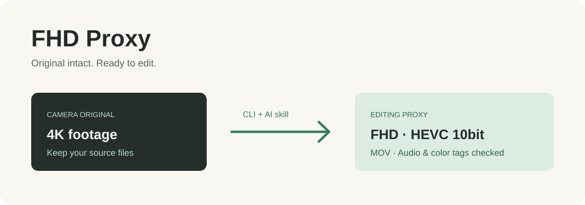

# FHD Proxy



## 원본은 그대로, 편집은 가볍게.

촬영 영상을 **편집용 FHD 10bit HEVC MOV**로 만드는 CLI와 AI 스킬입니다. macOS VideoToolbox를 기본으로 사용합니다.

```text
4K 촬영 원본 → 1920×1080 범위의 프록시 → DaVinci Link Proxy Media
```

[최신 릴리스](https://github.com/leeyekrj/fhd-proxy/releases/latest) · [스킬](skills/fhd-proxy/SKILL.md) · [MIT](LICENSE)

## 설치

Python 3.9+와 FFmpeg가 필요합니다. 기본 하드웨어 인코더는 macOS용이며, 실제 검증은 Apple Silicon macOS에서 진행했습니다. `libx265` 옵션은 FFmpeg 빌드가 지원하면 사용할 수 있습니다.

```bash
brew install python ffmpeg
curl -fsSL https://raw.githubusercontent.com/leeyekrj/fhd-proxy/main/install.sh | bash
```

기본 설치는 `~/.local/bin/fhd-proxy`. 이 폴더가 PATH에 없으면 전체 경로로 실행하거나 셸의 PATH에 추가하세요. 설치기는 같은 이름의 다른 파일을 덮어쓰지 않습니다.

## 사용

```bash
# 폴더 바로 아래 영상 → 각 폴더의 Proxy/같은 이름.mov
fhd-proxy "/Volumes/Camera/Card A" --dry-run
fhd-proxy "/Volumes/Camera/Card A"

# 다른 디스크에 저장 / 다른 작업 중에는 하나씩
fhd-proxy "clip.mov" --output "$HOME/Movies/Proxies" --jobs 1

# macOS 하드웨어 인코더의 화질 1~100 (기본 75)
fhd-proxy "clips" --quality 65

# 소프트웨어 HEVC (별도 CRF 22 고정, --quality는 적용되지 않음)
fhd-proxy "clip.mov" --encoder libx265 --jobs 1
```

## 무엇을 보존하나요?

- 원본 파일과 기존 출력은 덮어쓰지 않습니다. 출력 이름 충돌은 인코딩 전에 거부합니다.
- 가로·세로 비율을 유지하며 1920×1080 안에 맞추고 확대하지 않습니다. 세로 영상은 예를 들어 606×1080이 됩니다. GOP는 12프레임입니다.
- HEVC Main10, 오디오는 모든 트랙을 복사합니다. MOV에 호환되지 않는 오디오는 변환에 실패하며 원본은 그대로입니다.
- 알려진 색 태그와 풀/비디오 레인지를 전달합니다. VideoToolbox가 바꾸는 HEVC VUI 레인지는 비트스트림에서 보정합니다. 태그가 없는 소스에 BT.709 등을 추측해 넣지 않습니다. LUT·톤매핑·색 공간 변환은 하지 않습니다.
- 출력의 길이·해상도·10bit·알려진 색 태그·오디오 개수·존재하는 타임코드를 검사합니다. 통과한 파일만 최종 이름으로 확정합니다. 태그 검증은 편집기에서의 실제 색 일치를 보증하지 않으므로 중요한 원본은 시각적으로도 대조하세요.

일부 파일 실패·기존 출력 존재는 종료 코드 1, 취소는 130입니다. 배치 일부만 성공해도 전부 완료로 보고하지 않습니다. 기존 출력 때문에 실패했다면 파일을 확인하거나 다른 출력 폴더로 실행하세요. 임시 파일은 실패·Ctrl-C 시 정리됩니다. 강제 종료 시 남는 `.fhd-proxy-*`는 해당 작업이 끝난 뒤 정리할 수 있습니다.

프록시는 목표 용량 압축 도구가 아닙니다. 크기와 속도는 영상·인코더에 따라 다릅니다. 원본을 삭제하지 마세요.

## AI 스킬도 설치

CLI와 스킬을 함께 설치하려면 설치 대상만 지정하면 됩니다.

```bash
# Codex 예시. Claude Code는 --skill-dir "$HOME/.claude/skills"
curl -fsSL https://raw.githubusercontent.com/leeyekrj/fhd-proxy/main/install.sh \
  | bash -s -- --skill-dir "$HOME/.codex/skills"
```

스킬은 [skills/fhd-proxy/SKILL.md](skills/fhd-proxy/SKILL.md)에 있습니다. 기존 스킬 폴더는 덮어쓰지 않습니다. 설치 후 도구를 다시 열면 `fhd-proxy` 스킬을 사용할 수 있습니다. 현재 대화에서의 GitHub 게시 권한이 스킬을 통한 다른 게시 권한으로 이어지지 않습니다.

## DaVinci Resolve 연결

미디어 풀에서 원본 클립 선택 → **Link Proxy Media** → 프록시 폴더. 편집은 **Prefer Proxies**, 최종 렌더는 **Use proxy media**를 끄고 원본으로 확인하세요. 여러 카메라에 같은 파일명이 있으면 폴더별로 연결합니다.

## 검증과 라이선스

```bash
python3 -m unittest discover -s tests -v
```

실제 FFmpeg 합성 영상으로 10bit·풀레인지·BT.2020/HLG·오디오·타임코드·원본 보존·기존 출력 거부를 확인합니다. 소스와 스킬은 MIT. FFmpeg는 외부 의존성이며 릴리스에 포함하지 않습니다. [외부 구성요소](THIRD_PARTY_NOTICES.md), [FFmpeg 라이선스 안내](https://ffmpeg.org/legal.html).
